

  <picture>
    <source media="(prefers-color-scheme: dark)" srcset="./IMG/library-header-dark.avif">
    <source media="(prefers-color-scheme: light)" srcset="./IMG/library-header-light.avif">
    
  </picture>

 

  

    <i>Una biblioteca de apuntes, notas y documentación.</i>
  

  
  

---

Aquí no encontrarás los libros originales, sino **notas, conceptos, apuntes propios y documentación** que merece la pena conservar y consultar en el futuro. También hay lecturas pasivas o de investigación para recopilar ideas para mi [Roadmap](https://github.com/Ikastoki/roadmap).

## Catálogo

| Colección                                    | Descripción                                        |
| :------------------------------------------- | :------------------------------------------------- |
| [Apuntes](#apuntes)                          | Apuntes propios sobre: Front-End, Back-End, extra. |
| [Libros - Fundamentos](#fundamentos)         | Libros sobre conceptos básicos más trasversales.   |
| [Libros - Desarrollo de Software](#software) | Libros enfocados al desarrollo de software.        |

---

## Apuntes

### Front-End

<table>
  <tr>
    <td width="33%" align="center" valign="top">
      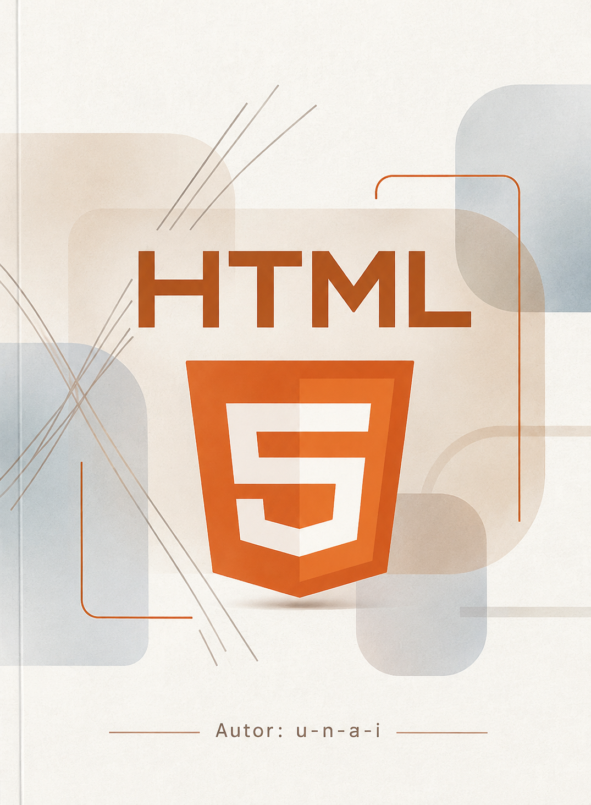
      <h3>HTML</h3>
      Autor: <a href="https://github.com/u-n-a-i">u-n-a-i</a>
      

      <a href="./Apuntes/Front-End/HTML/README.md">
        📖 <b>Mis apuntes</b>
      </a>
    </td>
    <td width="33%" align="center" valign="top">
      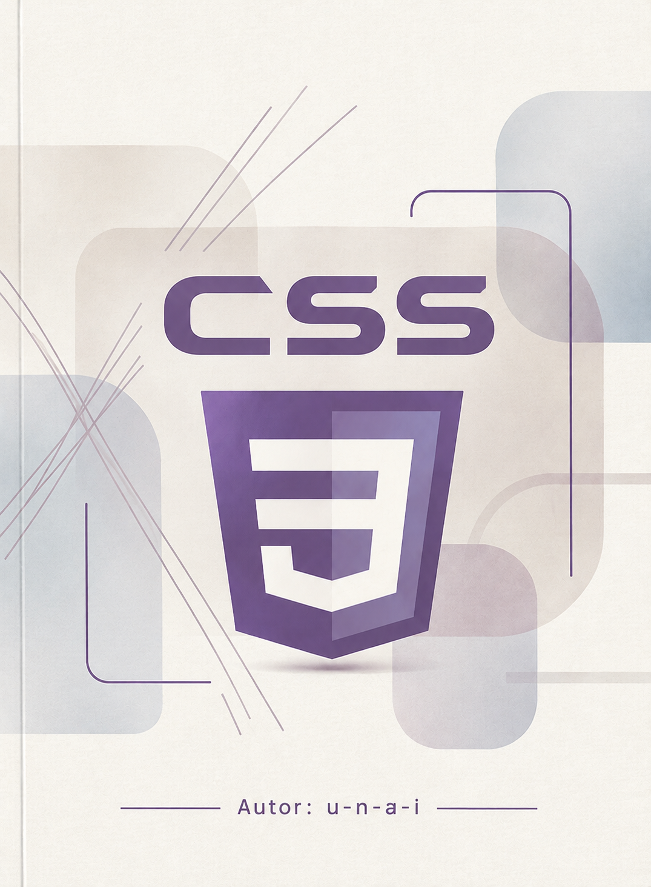
      <h3>CSS</h3>
      Autor: <a href="https://github.com/u-n-a-i">u-n-a-i</a>
      

      <a href="./Apuntes/Front-End/CSS/README.md">
        📖 <b>Mis apuntes</b>
      </a>
    </td>
    <td width="33%" align="center" valign="top">
      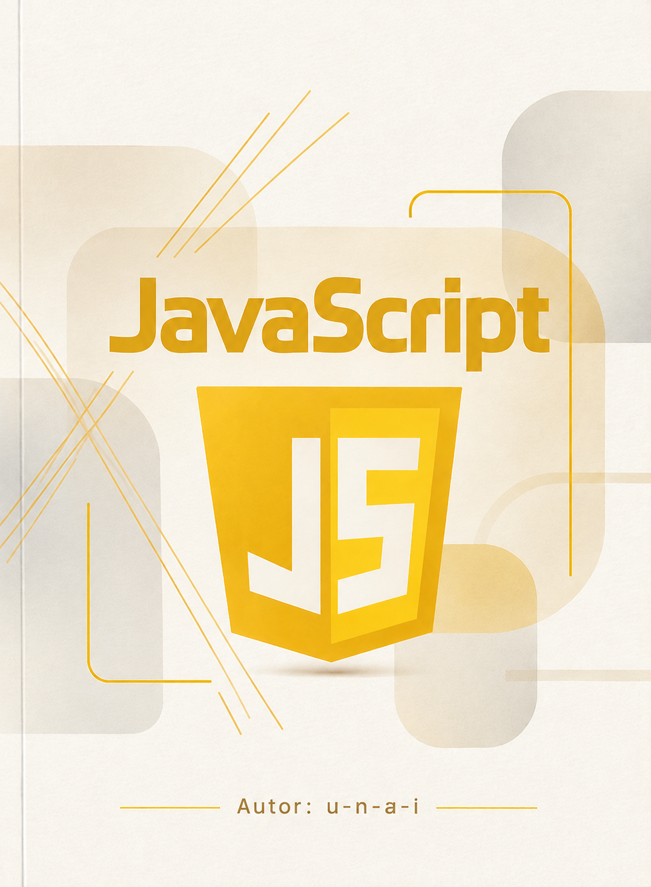
      <h3>JavaScript</h3>
      Autor: <a href="https://github.com/u-n-a-i">u-n-a-i</a>
      

      <a href="./Apuntes/Front-End/JavaScript/README.md">
        📖 <b>Mis apuntes</b>
      </a>
    </td>
  </tr>
  <tr>
    <td width="33%" align="center" valign="top">
      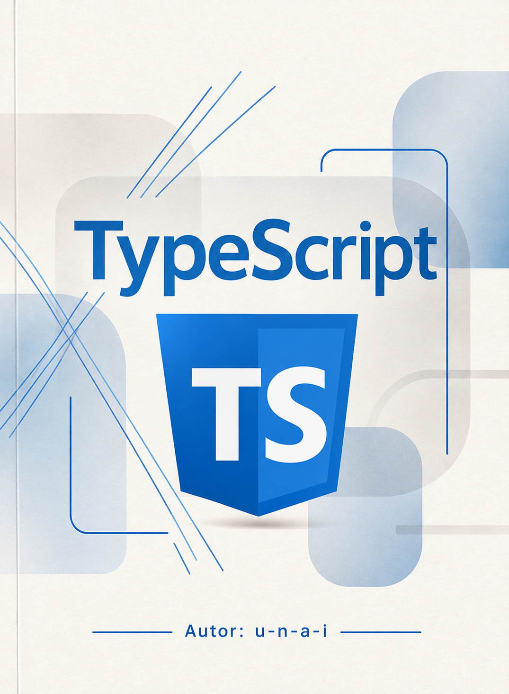
      <h3>TypeScript</h3>
      Autor: <a href="https://github.com/u-n-a-i">u-n-a-i</a>
      

      <a href="">
        📖 <b>Mis apuntes</b>
      </a>
    </td>
    <td width="33%" align="center" valign="top">
      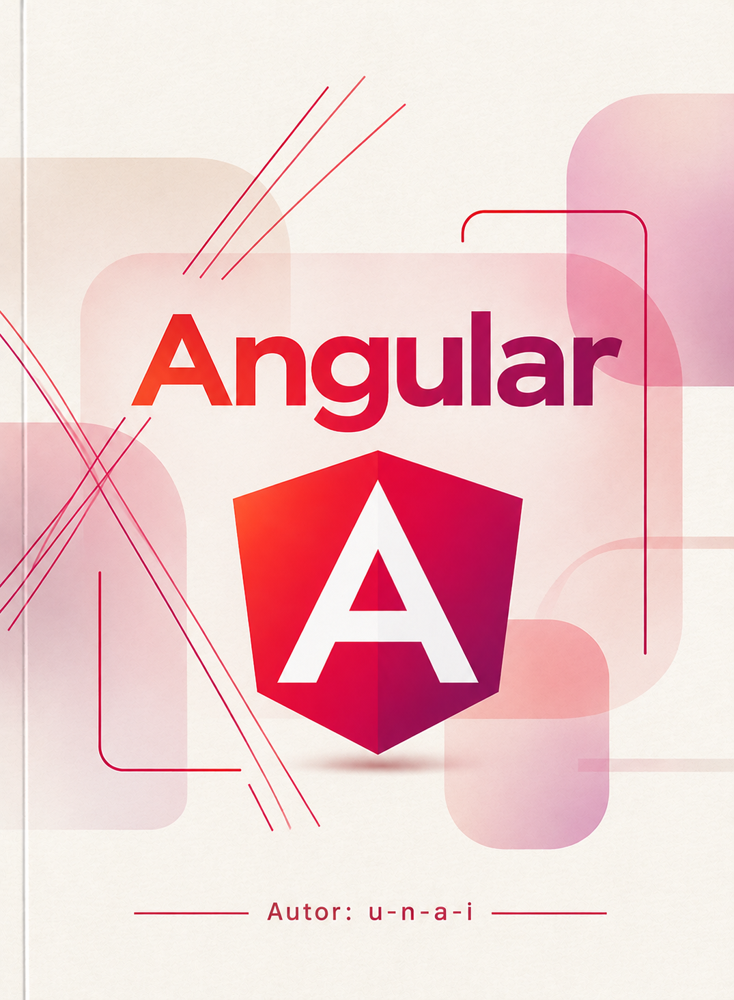
      <h3>Angular</h3>
      Autor: <a href="https://github.com/u-n-a-i">u-n-a-i</a>
      

      <a href="">
        📖 <b>Mis apuntes</b>
      </a>
    </td>
  </tr>
</table>

## Libros

### Fundamentos

<table>
  <tr>
    <td width="33%" align="center" valign="top">
      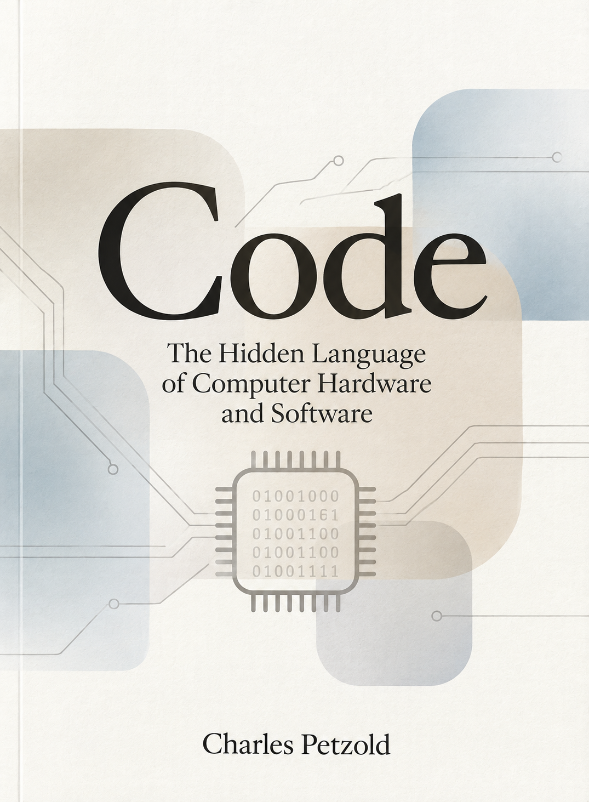
      <h4>Code:The Hidden Language of Computer Hardware and Software</h4>
      Autor: <a href="https://en.wikipedia.org/wiki/Charles_Petzold">Charles Petzold</a>
      

      <a href="./Fundamentos/Code The Hidden Language of Computer Hardware and Software.md">
        📖 <b>Mis apuntes</b>
      </a>
       
      <a href="https://www.amazon.es/C%C3%B3digo-Segunda-edici%C3%B3n-lenguaje-ESPECIALES-ebook/dp/B0BT56TPDV">
        🛒 <b>Obtener libro</b>
      </a>
    </td>
    <td width="33%" align="center" valign="top">
      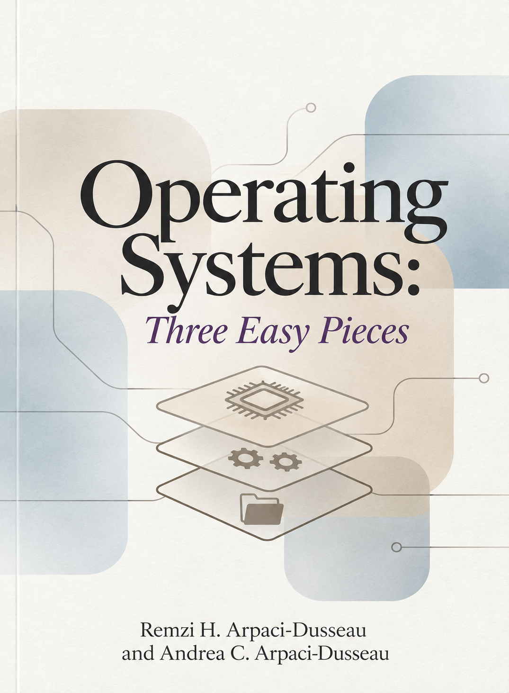
      <h4>Operating Systems Three Easy Pieces</h4>
      Autor: <a href="https://pages.cs.wisc.edu/~remzi/OSTEP/">Remzi, Andrea</a>
      

      <a href="./Fundamentos/Operating Systems Three Easy Pieces.md">
        📖 <b>Mis apuntes</b>
      </a>
       
      <a href="https://pages.cs.wisc.edu/~remzi/OSTEP/">
        🛒 <b>Obtener libro</b>
      </a>
    </td>
    <td width="33%" align="center" valign="top">
      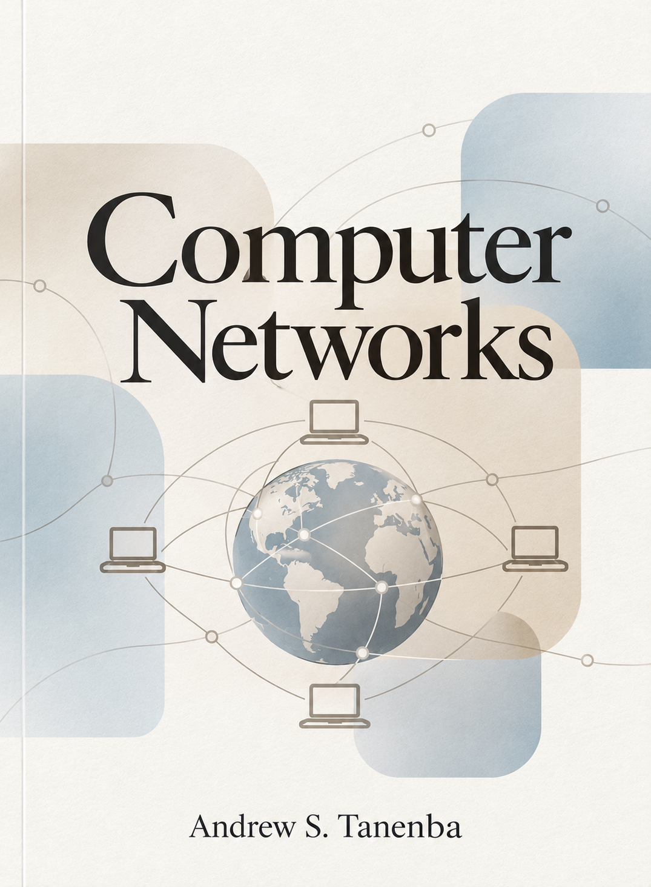
      <h4>Computer Networks</h4>
      Autor: <a href="https://es.wikipedia.org/wiki/Andrew_S._Tanenbaum">Andrew S. Tanenbaum</a>
      

      <a href="./Fundamentos/Computer Networks.md">
        📖 <b>Mis apuntes</b>
      </a>
       
      <a href="https://www.amazon.es/Computer-Networks-Andrew-S-Tanenbaum/dp/9332518742?__mk_es_ES=%C3%85M%C3%85%C5%BD%C3%95%C3%91&crid=3LMPHFSKY18QZ&dib=eyJ2IjoiMSJ9.L8UdxlX46pRgFe7ejAK2d39VriCPna40PnTDjMP37G4TPeOZF31gyS8itpH9kTrNa2usbzdzC7POQaRHHbDWjI84QOKgPcEQmnYU92-rbmK8LTAgEbMBol07XJBjVdw_.PLZOzAUPIdvjOa4bgy6iWfGduRGiWYmmlzHPufxD7JI&dib_tag=se&keywords=Andrew_S._Tanenbaum+network&qid=1794416731&s=digital-text&sprefix=andrew_s._tanenbaum+network%2Cdigital-text%2C81&sr=1-2">
        🛒 <b>Obtener libro</b>
      </a>
    </td>
  </tr>
  <tr>
    <td width="33%" align="center" valign="top">
      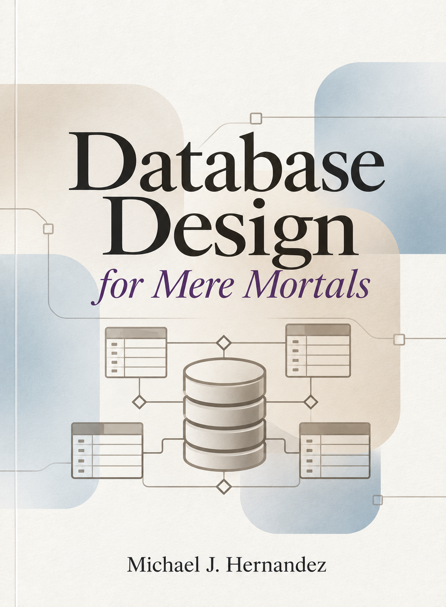
      <h4>Database Design for Mere Mortals </h4>
      Autor: <a href="">Michael J. Hernandez</a>
      

      <a href="./Fundamentos/Computer Networks.md">
        📖 <b>Mis apuntes</b>
      </a>
       
      <a href="https://www.amazon.es/Database-Design-Mere-Mortals-Hands/dp/0201752840">
        🛒 <b>Obtener libro</b>
      </a>
    </td>
    <td width="33%" align="center" valign="top">
      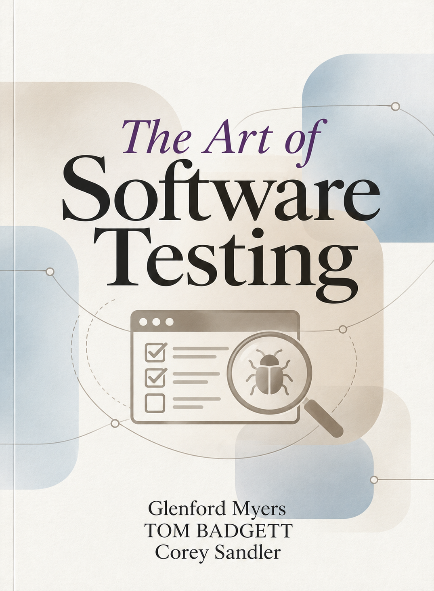
      <h4>The Art of Software Testing</h4>
      Autor: <a href="https://www.amazon.es/Art-Software-Testing-Third/dp/1118031962">Glenford, Tom y Corey</a>
      

      <a href="./Fundamentos/The Art of Software Testing.md">
        📖 <b>Mis apuntes</b>
      </a>
       
      <a href="https://www.amazon.es/Art-Software-Testing-Third/dp/1118031962">
        🛒 <b>Obtener libro</b>
      </a>
    </td>
    <td width="33%" align="center" valign="top">
      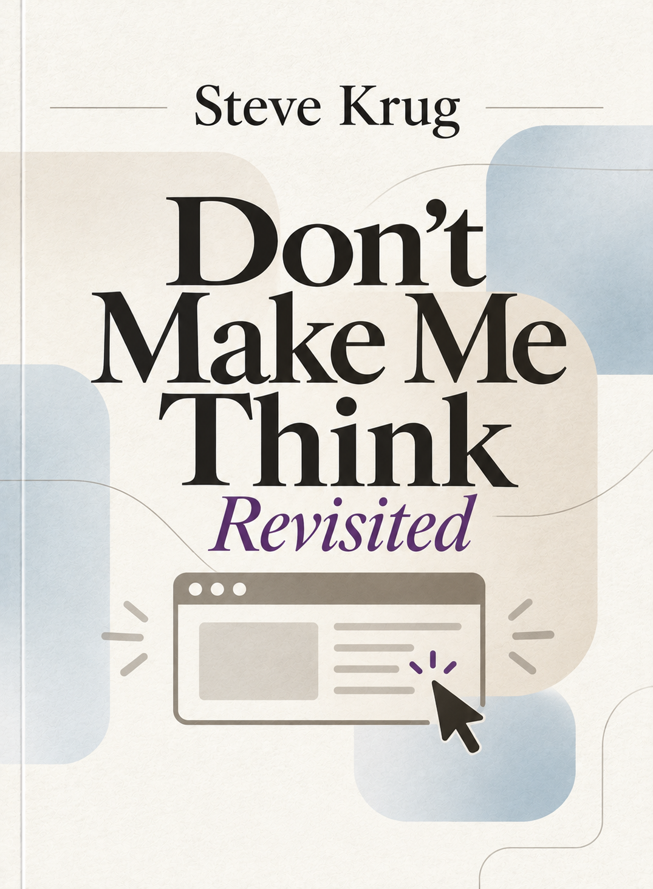
      <h4>Don't Make Me Think, Revisited</h4>
      Autor: <a href="https://www.amazon.es/stores/Steve-Krug/author/B001KHCFUU?ref=ap_rdr&shoppingPortalEnabled=true">Steve Krug</a>
      

      <a href="./Fundamentos/Don&apos;t Make Me Think.md">
        📖 <b>Mis apuntes</b>
      </a>
       
      <a href="https://www.amazon.es/Dont-Make-Think-Revisited-Usability/dp/0321965515">
        🛒 <b>Obtener libro</b> 
      </a>
    </td>
  </tr>
  <tr>
    <td width="33%" align="center" valign="top">
      
      <h4>Computer Security: Principles and Practice</h4>
      Autor: <a href="">Lawrie Brown, William Stallings</a>
      

      <a href="./Fundamentos/Computer Security Principles and Practice.md">
        📖 <b>Mis apuntes</b>
      </a>
       
      <a href="https://www.amazon.es/Computer-Security-Principles-William-Stallings/dp/0132775069">
        🛒 <b>Obtener libro</b>
      </a>
    </td>
    <td width="33%" align="center" valign="top">
      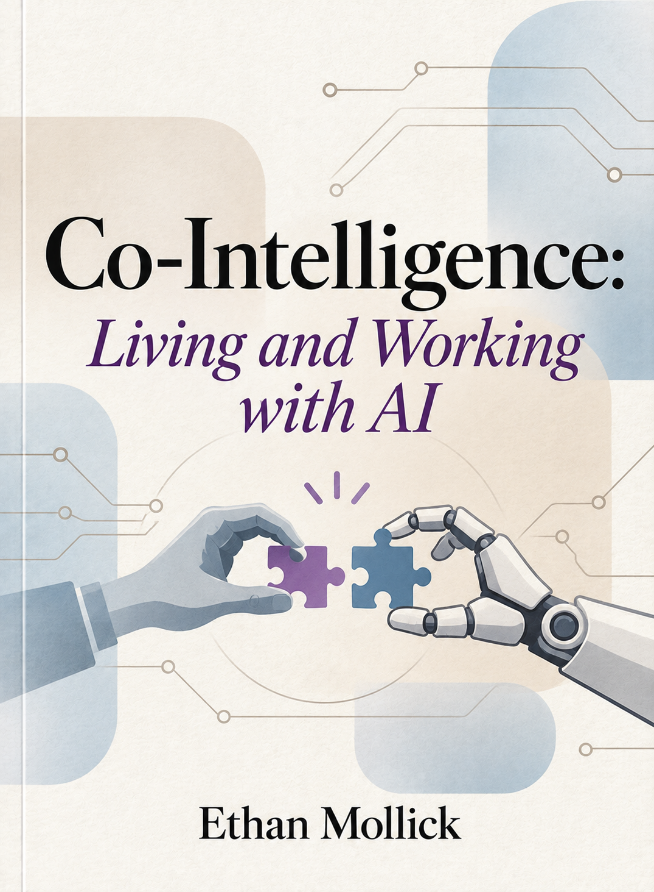
      <h4>Co-Intelligence: Living and Working with AI</h4>
      Autor: <a href="https://en.wikipedia.org/wiki/Ethan_Mollick"> Ethan Mollick</a>
      

      <a href="./Fundamentos/Co-Intelligence Living and Working with AI.md">
        📖 <b>Mis apuntes</b>
      </a>
       
      <a href="https://www.amazon.es/-/en/Co-Intelligence-Living-Working-Ethan-Mollick/dp/059371671X">
        🛒 <b>Obtener libro</b>
      </a>
    </td>
  </tr>
</table>

## Sobre las fuentes

Los apuntes contienen explicaciones, reflexiones y aprendizajes a partir de las obras citadas. Su objetivo es facilitar el estudio y compartir conocimiento, no sustituir las publicaciones originales.

Los libros y demás materiales citados pertenecen a sus respectivos autores y titulares de derechos. Las citas y los materiales de terceros se identifican cuando corresponde.

---

  
<i>
    Esto es una biblioteca.

  Si necesitas que te preste un libro, puedes escribirme a [contacto](mailto:work.alias.unsaved790@passmail.net).

  **Atentamente,**  
  El bibliotecario.
  </i>

